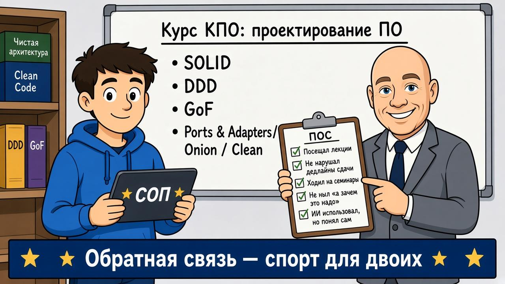
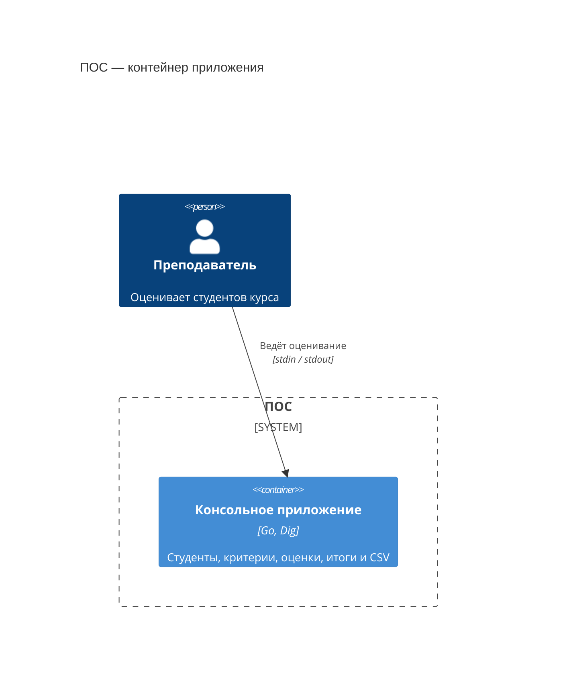
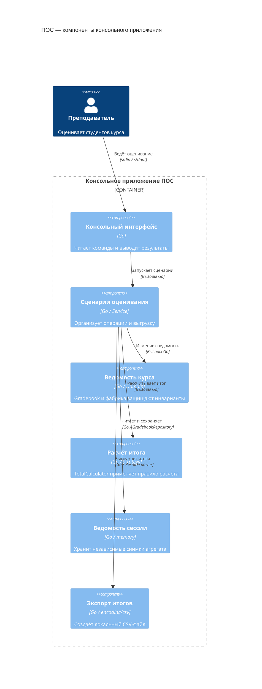

# ДЗ №2 по курсу КПО: ПОС


Выполнил: студент БПИ252 Гришин Алексей Андреевич

<center>
<kbd>
  
</kbd>
</center>

Консольное приложение «ПОС» — преподавательская оценка студентов:
участники курса, рубрикатор, выставление и исправление оценок,
взвешенный итог и экспорт ведомости в CSV.

## Запуск и проверка

Нужна **Go 1.27 или новее**. Команды выполняются из корня проекта;
при первом запуске Go загружает зависимости из `go.mod` и `go.sum`.

```bash
go run -buildvcs=false ./cmd/pos
```

Выберите действие по номеру и отвечайте на вопросы, завершая строки Enter.
`0` в главном меню завершает работу. Данные хранятся в памяти одной сессии;
после выхода остаются только экспортированные файлы.

| Команда | Действие |
| --- | --- |
| `go test -buildvcs=false -race ./...` | Все тесты с проверкой гонок |
| `go vet ./...` | Статические проверки Go |
| `go build -buildvcs=false -o /tmp/pos-hw2 ./cmd/pos` | Сборка приложения |
| `sh scripts/demo.sh` | Готовый сценарий, протокол консоли и три CSV-ведомости |

Флаг `-buildvcs=false` отключает сбор сведений о системе контроля версий.

## Правила оценивания

- Студенты и критерии получают отдельные последовательности ID.
  Одинаковые имена допустимы: участники и критерии различаются по ID.
  [Списки](internal/domain/gradebook.go) возвращаются в порядке добавления.
- Имя студента и название критерия непустые. Максимум и вес — положительные
  конечные числа. Для дробных значений в консоли используется точка.
- [Оценка](internal/domain/evaluation.go) выставляется существующему студенту
  по критерию из рубрикатора. Балл конечный и находится в `[0, max_score]`.
  Ноль считается выставленной оценкой.
- На пару студент/критерий приходится одна текущая оценка. Повторное выставление
  запрещено; для изменения есть отдельный сценарий. Исправление и отмена требуют
  существующую оценку. Ошибочная операция не меняет ведомость.
- [Итог](internal/domain/total.go) рассчитывается на шкале 0–10:
  `10 × Σ(вес × балл / максимум) / Σ(вес)`. Веса нормируются суммой;
  они не обязаны давать 1 или 100. При максимумах 10/20, весах 1/3 и баллах 8/10
  итог равен 5.75. Формула и правила пропусков — выбранные решения,
  поскольку условие не задаёт их точно.
- Окончательный итог требует всех оценок. Предварительный считает пропуски
  нулями, используя весь рубрикатор. Пустой рубрикатор — ошибка.
  После изменения оценок или критериев следующий расчёт использует новые данные.
  Округление до двух знаков выполняется только при выводе и экспорте.
- [Ведомость](internal/application/results.go) строится из одного снимка данных.
  В CSV готовый итог имеет статус `final`; для неполной ведомости поле `total`
  пустое, статус — `incomplete`. Выставленный ноль экспортируется как `0.00`.
  [Экспортёр](internal/adapters/csv/exporter.go) создаёт новый файл и отклоняет
  существующий путь. Ошибки записи и закрытия возвращаются в консоль.

## Карта DDD

Единый язык совпадает с предметной областью и меню; код использует английские
эквиваленты тех же терминов.

| Понятие | Реализация и роль |
| --- | --- |
| Студент | [Student](internal/domain/student.go) — Entity, идентичность по `StudentID` |
| Критерий | [Criterion](internal/domain/criterion.go) — Entity с максимумом и весом, идентичность по `CriterionID` |
| Рубрикатор | Коллекция `Gradebook.criteria`, доступная через `Criteria()` |
| Оценка | [Evaluation](internal/domain/evaluation.go) — Entity с ключом студент/критерий |
| Балл и вес | `Score` и `Weight` — неизменяемые Value Object с проверкой значений |
| Ведомость курса | [Gradebook](internal/domain/gradebook.go) — корень агрегата |
| Итог | `Total` — вычисленный снимок результата; [TotalCalculator](internal/domain/total.go) — Domain Service |
| Хранение и выгрузка | [GradebookRepository](internal/application/service.go) и [ResultExporter](internal/application/results.go) — выходные порты |

Два студента «Иван Иванов» с ID 1 и 2 — разные Entity. Исправление балла
с 8 на 10 сохраняет идентичность Evaluation по той же паре ID.
Два корректных `Score` со значением 8 равны по значению независимо от студента;
то же верно для двух `Weight` со значением 3. У Value Object нет собственного ID
и методов изменения. Верхнюю границу Score проверяет фабрика оценки,
поскольку она зависит от выбранного критерия.

### Граница агрегата

```text
Gradebook
├── students: []Student
├── criteria: []Criterion
└── evaluations: []Evaluation
```

В одном агрегате находятся участники курса, рубрикатор и оценки. Это позволяет
при изменении проверить сразу существование студента и критерия, максимум балла
и единственность оценки. В приложении один курс и последовательная работа;
поэтому одна ведомость — небольшая единица согласованности.

Изменения выполняются методами корня. Поля закрыты, методы чтения возвращают
копии. Отдельных репозиториев сущностей нет: загружается и сохраняется вся
Gradebook. Memory-адаптер копирует её на обеих границах; несохранённые изменения
не попадают в хранилище. Конструкторы и методы агрегата защищают инварианты
при прямом вызове без CLI.

TotalCalculator объединяет рубрикатор с оценками, поэтому расчёт вынесен
в Domain Service. Фасад загружает данные, калькулятор получает агрегат
и стратегию расчёта. Стратегия возвращает `TotalCalculation`: числовой результат
и признак предварительности. Это открытый результат вычисления, который
может создать реализация из другого пакета. Калькулятор проверяет конечность,
диапазон 0–10 и полноту окончательного итога, затем создаёт закрытый `Total`
с ID студента и счётчиками из текущей ведомости. Итог возвращается как значение
и не хранится отдельно от исходных оценок. Репозиторий, экспортёр и консоль
находятся вне агрегата.

## Архитектура и слои

Выбрана **Ports and Adapters**.

| Пакет | Ответственность |
| --- | --- |
| [domain](internal/domain) | Entity, Value Object, инварианты, агрегат и расчёт итога |
| [application](internal/application) | Сценарии, фасад, порты и DTO итоговой ведомости |
| [adapters/memory](internal/adapters/memory) | Снимки ведомости в памяти |
| [adapters/csv](internal/adapters/csv) | Формат CSV и запись файла |
| [adapters/cli](internal/adapters/cli) | Меню, ввод и вывод |
| [bootstrap](internal/bootstrap) | Сборка зависимостей |
| [cmd/pos](cmd/pos) | Запуск и код завершения процесса |

`domain` зависит только от стандартной библиотеки. `application → domain`;
CLI и CSV используют сценарии и их контракты, memory — доменные типы.
Приложение работает с портами, а конкретные реализации связывает bootstrap.
В домене нет ссылок на консоль, файлы или DI.

[NewConsole](internal/bootstrap/bootstrap.go) использует **go.uber.org/dig
v1.19.0**. Через `Provide` регистрируются потоки ввода/вывода,
memory-хранилище как GradebookRepository, CSV-экспортёр как ResultExporter,
конструкторы Service и Console. Через `Invoke` получается готовая консоль,
которую запускает main. В одном контейнере используется одно хранилище;
новый контейнер получает независимую ведомость. Бизнес-логика не обращается к Dig.

### Соглашения кода

- У одного типа используется один вид получателя. Изменяемые объекты
  `Gradebook`, `Service`, `Repository`, `Console` и `TotalCalculator` используют
  `*T`; небольшие типы значений и стратегии без состояния — `T`.
  Получатель-указатель сам по себе не означает изменение объекта:
  методы чтения сохраняют состояние, а коллекции возвращают копиями.
- Свободные функции проверяют входные значения, создают объекты или вычисляют
  результат. Изменение агрегата, сохранение, ввод/вывод и экспорт выполняют
  методы соответствующих объектов. `main` запускает процесс,
  bootstrap создаёт локальный граф зависимостей.
- Формирование CSV-записей отделено от записи файла. Метод экспортёра владеет
  выходным потоком и закрывает его также при ошибке записи.
  `Console.promptLine` явно объединяет приглашение и чтение строки,
  `Console.printError` печатает ошибку операции и возвращает ошибку вывода.
- Нормальное завершение входного потока отмечается отдельно от ошибок I/O.
  Ошибка записи, даже `io.EOF`, возвращается вызывающему коду и не выдаётся
  за штатный конец ввода.
- Комментарии написаны на английском в стиле GoDoc: имя объявления,
  назначение и существенные условия использования. Экспортируемые объявления
  документированы; внутренние комментарии объясняют неочевидные решения.

### C4: контейнер приложения (L2)

Приложение работает одним процессом Go; ведомость хранится в памяти этого
процесса. Экспорт создаёт отдельный локальный CSV-файл.



### C4: компоненты приложения (L3)



Стрелки L3 показывают взаимодействия во время работы, а не импорты пакетов.
Service обращается к хранению и экспорту через интерфейсы; реализации
связывает bootstrap при запуске.

## Паттерны GoF

Используется по одному паттерну каждой группы. В порождающей группе выбрана
фабрика Evaluation из примера задания.

| Группа | Паттерн, место и обоснование |
| --- | --- |
| **Порождающий — фабрика** | [EvaluationFactory](internal/domain/evaluation.go) создаёт оценку с проверкой студента, критерия и диапазона балла. И выставление, и исправление используют один путь создания; проверку максимума нельзя обойти через исправление. Агрегат отдельно проверяет дубликаты и наличие исправляемой оценки. |
| **Структурный — Facade** | [Service](internal/application/service.go) даёт консоли готовые сценарии: загрузить снимок, вызвать модель и сохранить после успеха. Расчёт и экспорт также вызываются через фасад. Координация находится за пределами UI, инварианты остаются в модели. |
| **Поведенческий — Strategy** | [TotalStrategy](internal/domain/total.go) подменяет правило расчёта в TotalCalculator. FinalWeightedTotal требует всех оценок, PreliminaryWeightedTotal считает пропуски нулями. [Фасад](internal/application/total.go) выбирает реализацию для команд `9` и `10`; это два варианта одного паттерна. |

## Проверки модели

| Проверка | Что фиксирует |
| --- | --- |
| [TestInvalidEvaluationDoesNotChangeState](internal/domain/evaluation_test.go) | Неверные баллы и ссылки отклоняются при выставлении и исправлении; прежняя оценка сохраняется. |
| [TestTotalUsesCurrentEvaluationsAndRubric](internal/domain/total_test.go) | Исправление, отмена и новый критерий учитываются при следующем расчёте. |
| [TestTotalStrategyCanDefineANewFormulaOutsideDomain](internal/domain/total_test.go) | Внешняя стратегия рассчитывает другую формулу; калькулятор формирует метаданные и проверяет результат. |
| [TestTotalStrategyCannotMutateGradebook](internal/domain/total_test.go) | Даже изменение переданных стратегии коллекций не затрагивает агрегат. |
| [TestInvalidEvaluationScenariosDoNotSave](internal/application/evaluation_test.go) | Ошибка модели завершает сценарий до Save; подставной репозиторий передаётся через конструктор Service. |
| [TestExportRoundTrip](internal/adapters/csv/exporter_test.go) | CSV читается обратно без потери кавычек, запятых и кириллицы; нулевые и отсутствующие итоги различаются. |
| [Сборка и изоляция DI-графа](internal/bootstrap/bootstrap_test.go) | Dig собирает рабочее приложение; отдельные контейнеры получают независимые хранилища. |
| [TestFullConsoleScenarioExportsCurrentTotals](internal/bootstrap/export_test.go) | Вся цепочка выполняется через CLI и DI; файлы до и после отмены совпадают с текущей ведомостью. |
| [TestOutputEOFIsNotTreatedAsEndOfInput](internal/adapters/cli/console_test.go) | Ошибка записи не скрывается как нормальный конец ввода. |

Тесты также проверяют ошибки портов, записи и закрытия файла, существующий
путь экспорта и EOF посреди формы. Тестовые файлы создаются в `t.TempDir()`.

Критический анализ, исправленные дефекты и ограничения решения:
[docs/REVIEW.md](docs/REVIEW.md).

## Использование ИИ

Для разработки использовался Codex. При работе с Go применялись рекомендации
Modern Go Guidelines.

При этом была проведена проверка предложенного ИИ кода на соответствие требованиям задания, разобрана его логика и вручную воспроизведены основные сценарии работы программы. По результатам проверки были исправлены найденные ошибки и упрощались отдельные решения. После изменений запускались тесты и проверялась сборка. ИИ помогал с реализацией и поиском вариантов, а окончательные решения я принимал после проверки и понимания предложенного кода. Подробнее — в [AI_USAGE.md](AI_USAGE.md).

## Демонстрация

[docs/DEMO.md](docs/DEMO.md) содержит полный сценарий, файлы ввода и ожидаемые
результаты: итог, CSV, ошибки, исправление и отмена оценок, незавершённый ввод.
